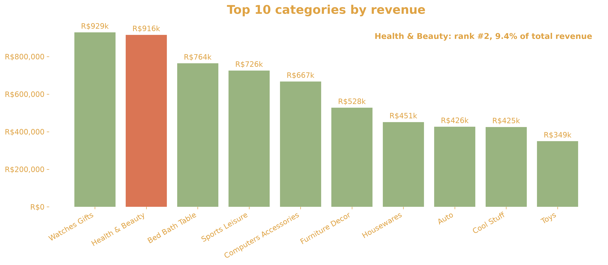
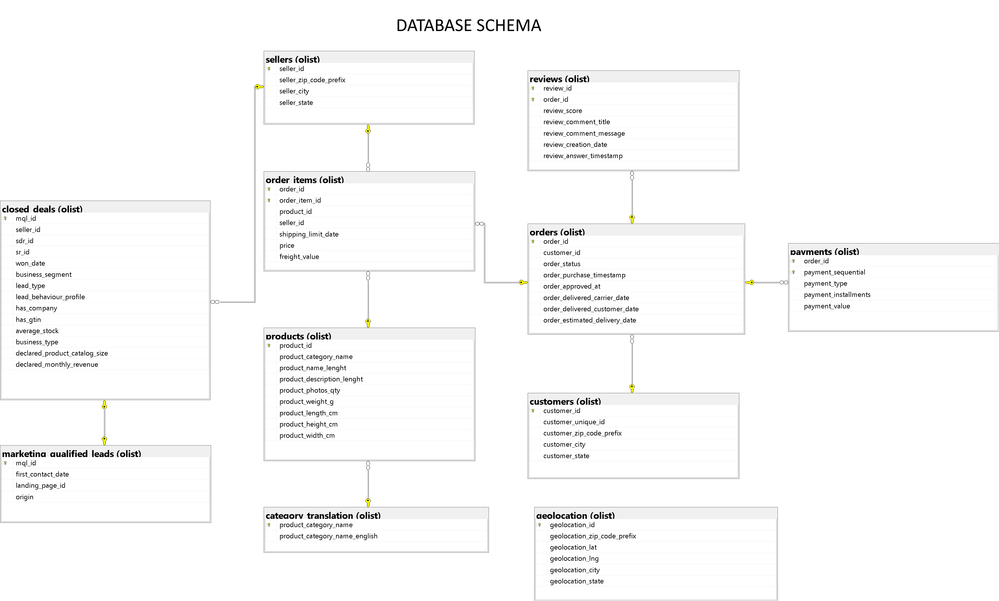
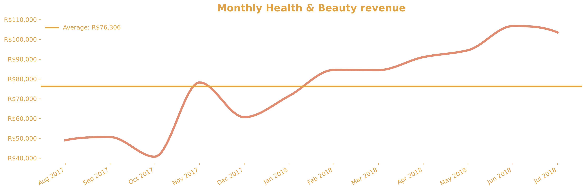
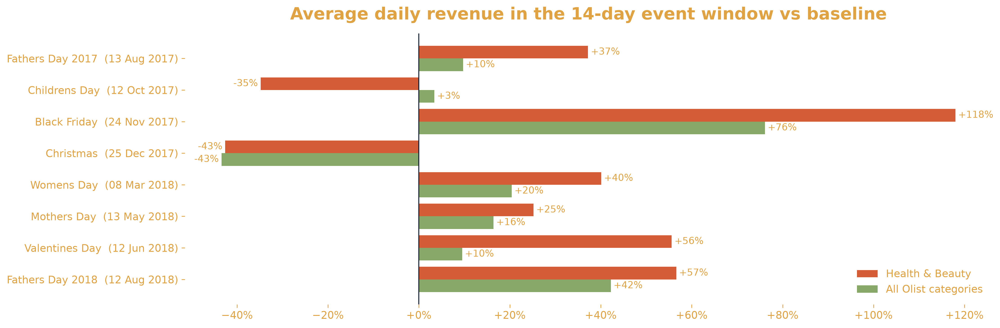

# Olist Health & Beauty Category Analysis
Edmond Antonian, 2026.10
Tools used: T-SQL, Python

## 1. Business Background
### 1.1 Client Background

**Olist** is a Brazilian ecommerce company that offers a wide range of online retail tools. These include a marketplace, an ERP system, marketplace integration, credit and financial services, a point-of-sale (POS) system and shipping.

This analysis uses **Olist** order data from September 2016 to October 2018. For the financial year, I use August 2017 to July 2018, the most recent period with complete data.

In this period, the dataset covers about 70k unique customers and more than 2.5k sellers, spread across almost all of Brazil. Revenue between August 2017 and July 2018 reached R$9.9 million (Brazilian reals) and grew steadily year on year.

Health and Beauty was one of the biggest contributors to this growth. Its revenue rose by around  280%, from almost R$250k (Oct 2016 to Sep 2017) to R$916k (Oct 2017 to Sep 2018), alongside a sharp rise in the number of orders. Understand  ing what made the category successful, and how to repeat it, can help the whole business.

### 1.2 Purpose and Audience
This report is written for the Category Management team and the Head of Operations. It reviews the category's performance over the last complete year, covering:
- sales trends
- customers and their satisfaction
- delivery performance
- seller growth
- the main factors behind these results

## 2. Key Metrics

- **Sales**
  - *Revenue(Gross Merchendise Value):* total price of items sold, excluding delivery charges, since we don't know take value of platform.
  - *Orders:* number of orders placed
  - *Units:* number of items sold
  - *Average order value (AOV):* revenue divided by number of orders
  - *Category share:* Health and Beauty revenue as a percentage of total Olist revenue
- **Customers**
  - *Unique customers:* people who bought at least once
  - *Repeat purchase rate:* share of customers who ordered more than once
- **Logistics**
  - *Delivery time:* days from purchase to arrival at the customer
  - *Late-delivery rate:* share of orders that arrived after the estimated date
  - *Freight share:* delivery charge as a percentage of item price
- **Customer Satisfaction**
  - *Average review score:* from 1 (worst) to 5 (best)
  - *Low-score share:* percentage of reviews scoring 1 or 2
- **Sellers and Geography**
  - *Seller concentration:* share of revenue coming from the top sellers
  - *Revenue by state:* where the category sells best

## 3. Executive Summary

1.

## 4. Database Structure and ERD

The data is stored in SQL Server as linked tables. Each order connects to a customer, its items, payments and review. Each item connects to a product and a seller.

**Main tables and key columns**

| Table | What it holds | Key columns | N. of rows |
|---|---|---|---|
| orders | One row per order | `order_id`, `order_status`, purchase and delivery dates | 99441 |
| order_items | Each product within an order | `price`, `freight_value`, `product_id`, `seller_id` | 112650 |
| products | Product details | `product_category_name`, weight, size, photo count | 32951 |
| category_translation | Portuguese-to-English category names | `product_category_name_english` | 73 |
| customers | Where each customer lives | `customer_unique_id`, city, state | 99441 |
| sellers | Where each seller is based | `seller_id`, city, state | 3095 |
| payments | How each order was paid | `payment_type`, `payment_installments`, `payment_value` | 103886 |
| reviews | Customer ratings and comments | `review_score`, `review_creation_date` | 99224 |
| geolocation | Map coordinates for postcodes | `geolocation_zip_code_prefix`, lat, lng | 1000163 |

The two marketing tables (`marketing_qualified_leads` and `closed_deals`) describe how sellers were recruited. They are not relevant to this analysis, so they are not used.	

**Data preparation notes**

- Only delivered orders are included.
- Category names were translated into English using the translation table.
- Revenue is the item price. Freight is analysed separately.
- Payments were compared with item price plus freight to check that revenue figures are reliable. Small discrepancy of around R$ 2k were found, which can be ignored.
- Products with no category are aggregated as "misc.".

## 5. Insights Deep-Dive

### 5.1 Category Overview
Olist has total of 73 categories. 
Health & Beauty(H&B) represents second-largest category, generating R$ 916k in revenue during a period under review, which is close to the leading category, Watches & Gifts.
H&B's share in total marketplace revenue is almost 10%, making it an important growth driver for the business. The category is also one of the largest categories in terms of product assortment, seller participation and customer base. 
H&B includes 1848 products, which is 7% of the total products sold on the marketplace. It is supported by 391 sellers representing 15.5% of active sellers, and 6402 customers, or 9.1% of all customers.

Compared with other categories, Health & Beauty demonstrates one of the strongest revenue growth rates. Although it started from a solid base, being already ranked second in a FY16-17, the category acheived 280% growth and remained in second place.
This suggests that the category is not only large, but also expanding at a pace that is strategically significant for future growth.

### 5.2 Sales Trend

1. #### Monthly Revenue
* H&B showd a steady declining trend before November 2017, followed by a sharp rise in November. This increase is likely associated with the promotional period surrounding Black Friday and other end-of-year marketing activity. 
* After sharp rise in November 2017, revenue corrected in December, after which the category entered a period of sustained growth.
* From December 2017 onward, the category increased by 70%, rising from R$60,688.75 to R$103,524.22. This suggests that the later part of the period was driven by a new level of demand rather than a one-off seasonal spike. 
* In order to understand where this growth originated, it is improtant to examine AOV, Number of orders and impact of marketing events during the given period.

2. #### Order Count, AOV

* Average order value fluctuated between R$130 and R$150, with an average of approximately R$141. The largest variations occurred between October 2017 and January 2018, which coincides with the peak period of promotional campaigns and holiday activity.
* After January 2018 AOV remained relatively stable around the average level, suggesting a period of stabilisation. It indicates that the category did not rely on price inflation to generate revenue growth.
* A similar pattern is visible in the order volume trend. Between October 2017 and January 2018, order counts recovered sharply and, unlike AOV, continued to rise steadily thereafter.
* This indicates that growth was driven primarily by higher transaction volume. By the end of the period, monthly order volume rises from a 338 orders to 699, with a pick at 790 orders.

3. #### Seasonality 

* Chart above illustrates how major popular holidays and marketing campaigns, such as Black Friday, influence sales. 
* A 14-day period before an event was selected as the campaign window. 
* A 28-day period before that window was used as the baseline for comparison.
* All events, except Children's day and Christmas resulted in a revenue uplift for the Health & Beauty, than for Olist overall.
* For Children's day, other categories delivered 4% revenue uplift, while H&B declined by 35%. This may be associated with a fact that children’s products are not a core target segment for the category.
* For the Christmas, the marketplace experienced a decline of -43%. This decline may be associated with a previous Black Friday campaign and and seasonal demand patterns.
* The most significant campaign was Black Friday, which delivered a 118% uplift in revenue for Health & Beauty. This aligns with the earlier charts, which showed a sharp increase in both order volume and AOV during the same period.

### 5.3 Product Performance

- Top and bottom products by revenue (using `product_id` or product attributes such as weight and photo count, since Olist has no sub-category).
- Price distribution and price-band analysis.
- Pareto (80/20) of products.

### 5.4 Customer Behaviour

- New vs repeat customers.
- Orders per customer and basket size.
- Payment methods and installments.

### 5.5 Regional Results

- Revenue and orders by state (map or bar chart).
- Freight cost and delivery time by state.
- Concentration in São Paulo vs underserved regions.

### 5.6 Seller Analysis

- Number of active sellers, top-seller revenue share, seller geography.
- Seller performance vs review score.

### 5.7 Delivery and Customer Satisfaction

- Review score distribution.
- Delivery time vs review score.
- Late deliveries and cancellation rate.
- Common complaint themes in review comments, if you use the text.

## 6. Recommendations

- **Sales:** 
- **Products:** 
- **Customers:** 
- **Regions:** 
- **Sellers and operations:** 

## 7. Limitations and Next Steps

- Data is a sample covering about two years, with no cost or margin data.
- Suggested follow-ups

## 8. Appendix

- SQL or Python code